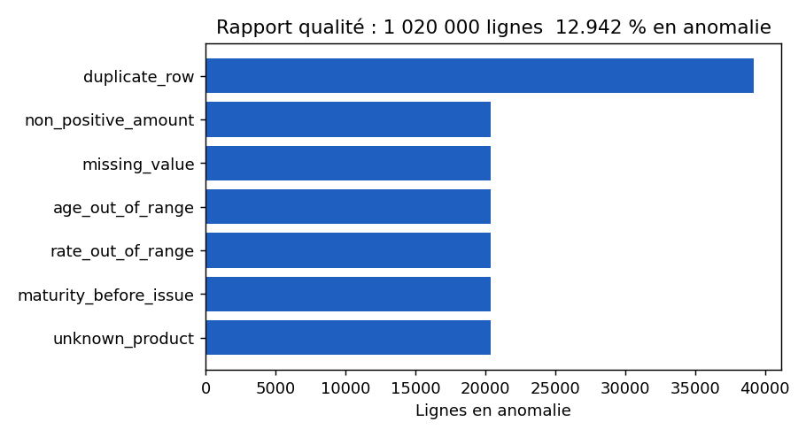

# Credit Data Quality Pipeline (PySpark + Airflow)

Pipeline de **contrôle qualité de données de crédit** : génération d'un jeu de prêts synthétique, règles de validation en PySpark, rapport JSON, orchestration Airflow, tests automatisés.

> ⚠️ **Données 100 % synthétiques**, générées par `src/dq/generate.py` (seed fixe). Ce dépôt ne contient aucune donnée ni aucun code issu d'un client.

> **EN —** Data-quality pipeline for credit data: 7 PySpark validation rules, a pass/fail gate on the anomaly rate, an Airflow DAG, Docker and pytest. 100 % synthetic data; the checks are verified against anomalies injected at a known rate.

## Le problème
Dans une banque, des données de crédit incorrectes (âges impossibles, doublons, échéances avant l'émission, valeurs manquantes) faussent le reporting réglementaire et les modèles de risque. Il faut les détecter **à chaque chargement** et pouvoir **bloquer** un lot trop dégradé, avant qu'il n'atteigne les utilisateurs.

## Ce que fait le projet
- Applique 7 règles de contrôle sur un gros volume (PySpark), produit un rapport chiffré et la liste des lignes en anomalie, avec la règle violée.
- Renvoie un code d'échec si le taux d'anomalies dépasse un seuil : le pipeline Airflow s'arrête au lieu de propager de mauvaises données.
- Est vérifiable : les anomalies sont injectées à taux connu, donc les tests prouvent que les contrôles retrouvent ce qui a été injecté.

## Ce que ça démontre (et ce que ça ne démontre pas)
Maîtrise de PySpark, de l'orchestration Airflow, de la qualité des données « as code », des tests et de Docker, dans un contexte crédit. Ce n'est **pas** un projet de production : données synthétiques, Spark en mode local, DAG non exécuté dans un Airflow réel.

## Architecture
```
generate.py ──► data/loans.parquet ──► dq.run (PySpark local[*])
                                          │  7 règles (checks.py)
                                          ├──► reports/dq_report.json
                                          └──► reports/anomalies/ (parquet, colonne `rule`)
Airflow DAG (dags/credit_dq_dag.py) : generate_synthetic_loans >> run_quality_checks
```

## Règles de contrôle
| Règle | Détection |
|---|---|
| `missing_value` | null **et NaN** sur les colonnes obligatoires |
| `age_out_of_range` | âge < 18 ou > 100 |
| `rate_out_of_range` | taux < 0 ou > 60 |
| `non_positive_amount` | montant ≤ 0 |
| `unknown_product` | produit hors liste autorisée |
| `maturity_before_issue` | échéance antérieure à l'émission |
| `duplicate_row` | lignes strictement identiques (toutes occurrences) |

## Lancer
```bash
pip install -r requirements.txt      # Java 11+ requis par Spark
make test                            # 6 tests pytest
make data                            # 1 000 000 lignes + anomalies
make run                             # rapport dans reports/dq_report.json
# ou
make docker
```
Le job retourne le code 1 si plus de `--max-anomaly-pct` (10 % par défaut) des lignes sont en anomalie. Avec les données synthétiques (≈ 13 % d'anomalies par construction), il **échoue donc volontairement** : c'est le comportement attendu d'un contrôle qualité qui bloque un chargement. Passer `--max-anomaly-pct 20` pour obtenir un code 0.

## Résultat mesuré
Sur 1 020 000 lignes (1 000 000 + 2 % de doublons injectés), Spark `local[*]`, exécution unique sur une machine de dev (8 cœurs, 3 Go de RAM, Python 3.10, Spark 3.5.1), le job a pris **~41 s** et signalé 132 004 lignes en anomalie (12,9 %), soit ~20 400 par type d'anomalie injectée (2 % chacun) et 39 196 lignes concernées par des doublons. Ce n'est pas un benchmark : une seule exécution, pas de réglage, et ce temps inclut l'écriture des anomalies.


*Graphique tracé à partir de `docs/sample_report.json` (sortie réelle du job sur 1,02 M de lignes).*

## Tests
- `tests/test_checks.py` : chaque règle sur de petits cas construits à la main, y compris les valeurs limites.
- `tests/test_end_to_end.py` : données générées avec anomalies injectées → les contrôles retrouvent le bon nombre de lignes ; génération reproductible.

Un test a mis en évidence un piège réel : un `NaN` pandas devient un `NaN` Spark, **pas** un `null` ; `isNull()` seul ne détecte donc rien. La règle `missing_value` traite les deux cas.

## Limites
- Spark en mode local uniquement (pas de cluster).
- Le DAG Airflow est fourni et vérifié syntaxiquement, mais **n'a pas été exécuté dans un Airflow réel** dans ce dépôt.
- Règles volontairement simples ; pas de profilage statistique ni de détection d'outliers.
